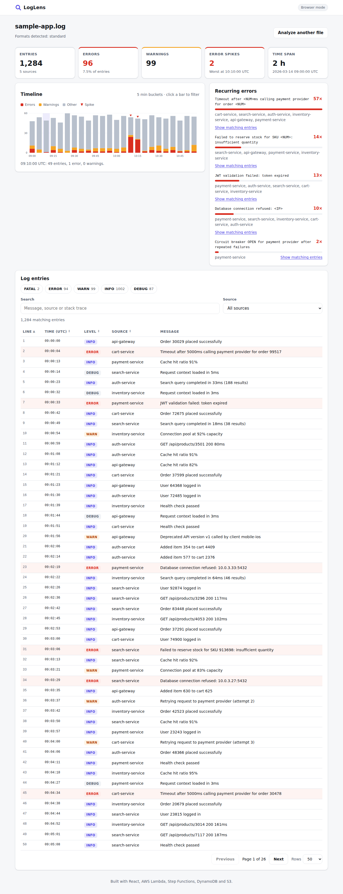
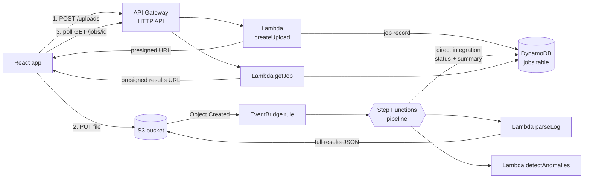

# LogLens: Log Analyser

A full-stack web application for finding problems in application logs. Upload a log file and LogLens shows error spikes on a timeline, groups recurring errors into patterns, and gives you a fast, searchable, filterable table of every entry, with stack traces kept together.

It runs in two modes:

- **Browser mode:** everything happens in your browser, and the file never leaves your computer. This is what the live demo uses.
- **Cloud mode:** the file goes to AWS and a serverless pipeline processes it (S3 → EventBridge → Step Functions → Lambda → DynamoDB), with results served through a REST API.

**Live demo:** `https://<your-github-username>.github.io/loglens/` *(see [Deploy the front end](#deploy-the-front-end-free))*



---

## Features

- **Multi-format parsing:** plain-text (`2026-03-14 10:22:01,123 ERROR [service] msg`), bracketed, JSON-lines and syslog. Formats are detected per line, so mixed files work.
- **Stack-trace grouping:** continuation lines are attached to the entry they belong to.
- **Error-spike detection:** time-bucketed error counts, with a z-score flagging buckets that are statistically unusual.
- **Recurring error patterns:** variable parts (numbers, IDs, IPs, UUIDs, quoted strings) are masked, so `Timeout after 3000ms for order 8812` and `Timeout after 5000ms for order 17` count as one problem.
- **Interactive timeline:** a stacked SVG bar chart. Click (or press Enter on) a bar to filter the table to that time window.
- **Filtering and search:** by level, source and free text (search covers stack traces too), with highlighted matches, sorting and pagination.
- **Accessible:** semantic landmarks, skip link, full keyboard support, `aria-live` status updates, `aria-sort` on table headers, visible focus, colour is never the only signal, and support for reduced motion. It's linted with `eslint-plugin-jsx-a11y`.
- **Responsive:** works on phones, with light and dark themes.

## Architecture



**The pipeline:** `ExtractJobId (Pass) → ParseLog (Lambda) → DetectAnomalies (Lambda) → SaveResults (DynamoDB)`. Each Lambda step retries on transient errors with exponential backoff. Any failure is caught and routed to `MarkFailed`, so a job never stays stuck in `PROCESSING`.

### Key design decisions

| Decision | Why |
|---|---|
| Browser uploads straight to S3 with a **presigned URL** | Large files never pass through Lambda or API Gateway, which have payload limits and charge per request. |
| **Step Functions** instead of one big Lambda | Each step is small and testable, retries are declarative, failures are visible in the console, and the flow is easy to extend (for example, add an OpenSearch indexing step). |
| Full results go to **S3**, and only aggregates flow through the state machine | Step Functions payloads are capped at 256 KB. |
| **DynamoDB direct integration** for saving results | No Lambda is needed just to write a record: less code and lower cost. |
| **Single-table DynamoDB** with a `ByEntity` GSI | Fetch a job by ID, or list recent jobs newest first, without scans. |
| **Shared core** (`backend/src/core`) used by both React and Lambda | One parser, one set of tests, identical results in both modes. |
| **Strategy pattern** for log formats | Adding a format means adding one object to `FORMAT_STRATEGIES`. |
| **Repository pattern** for DynamoDB access | Handlers work with "jobs" and never build keys themselves. |
| **Cost controls:** pay-per-request DynamoDB, TTL, S3 lifecycle expiry, arm64 Lambdas, API throttling | A demo account stays in or near the free tier. |
| **Security:** private encrypted bucket, least-privilege IAM from SAM policy templates, CORS limited to the front end's origin, input validation, sanitised S3 keys, no internal errors leaked to clients, GitHub OIDC for deploys (no stored AWS keys) | |

## Tech stack

| Area | Tools |
|---|---|
| Front end | React 18, Vite, JavaScript (ES2022), CSS custom properties, hand-built SVG chart |
| Back end | Node.js 22, AWS Lambda, API Gateway (HTTP API), Step Functions, DynamoDB, S3, EventBridge, AWS SDK v3 |
| Infrastructure as code | AWS SAM (CloudFormation), esbuild bundling |
| Testing | **Jest** + React Testing Library (front end), **Mocha** + Chai + aws-sdk-client-mock (back end), c8 / Jest coverage |
| Quality | ESLint (React, hooks, jsx-a11y), cfn-lint |
| CI/CD | GitHub Actions: lint → test → build → deploy (GitHub Pages and AWS via OIDC) |

## Project structure

```
loglens/
├── frontend/                  React app (Vite)
│   ├── src/
│   │   ├── components/        Dashboard, TimelineChart, LogTable, FilterBar, ...
│   │   ├── hooks/             useLogAnalysis: idle → loading → ready | error
│   │   ├── api/client.js      REST client for cloud mode
│   │   └── utils/filters.js   filtering, sorting, pagination, formatting
│   └── public/sample-app.log
├── backend/
│   ├── src/core/              parser + analyzer, shared with the front end
│   ├── src/handlers/          one file per Lambda
│   ├── src/lib/               jobsRepository (DynamoDB), storage (S3), http helpers
│   ├── statemachine/          Step Functions definition (ASL)
│   └── test/                  Mocha tests
├── template.yaml              AWS SAM: all infrastructure as code
├── samples/                   sample log + generator script
└── .github/workflows/         CI, back-end deploy, front-end deploy
```

## Run it locally

Requires Node.js 22+.

```bash
# Front end (browser mode)
cd frontend
npm install
npm run dev          # http://localhost:5173, then click "Try the sample log"

# Tests
npm test             # Jest (front end)
cd ../backend
npm install
npm test             # Mocha (back end + shared core)
```

## Deploy the back end to AWS

Requires the [AWS SAM CLI](https://docs.aws.amazon.com/serverless-application-model/latest/developerguide/install-sam-cli.html) and AWS credentials (`aws configure`).

```bash
cd backend && npm install && cd ..
sam build
sam deploy --guided        # first time: accept the defaults, region ap-south-1 (Mumbai)
```

Copy the `ApiUrl` output, then run the front end against it:

```bash
cd frontend
echo "VITE_API_URL=https://xxxx.execute-api.ap-south-1.amazonaws.com" > .env.local
npm run dev                # the header now shows "Cloud mode"
```

Remove everything with `sam delete` when you're done. With light use this stays within the AWS free tier, but set up a billing alarm anyway.

## Deploy the front end (free)

1. Push this repo to GitHub.
2. Go to **Settings → Pages → Source** and choose **GitHub Actions**.
3. Push to `main`. The `Deploy front end to GitHub Pages` workflow publishes the app at `https://<username>.github.io/<repo>/`.

For cloud mode on the live site, add a repository variable `VITE_API_URL` set to your `ApiUrl`, and redeploy the back end with `AllowedOrigin=https://<username>.github.io`.

## REST API

| Method | Path | Description |
|---|---|---|
| `POST` | `/uploads` | Body `{ fileName, size, contentType? }`. Creates a job and returns `{ jobId, uploadUrl }` (presigned S3 PUT, valid for 5 min). Only `.log .txt .json .jsonl .out` files up to 50 MB are accepted. |
| `GET` | `/jobs/{jobId}` | Job status: `PENDING_UPLOAD` → `PROCESSING` → `COMPLETE` or `FAILED`. When the job is complete, this includes the `summary` and a presigned `resultUrl`. |
| `GET` | `/jobs?limit=20` | Recent jobs, newest first. |

## Roadmap

- Index entries into **Amazon OpenSearch** for full-text search across many files
- **Amazon Cognito** sign-in so each user sees only their own jobs
- Parse large files in a **Web Worker** so the UI never blocks
- Migrate to **TypeScript**
- Streaming parse in Lambda for files over 100 MB
- Natural-language questions about a log using an LLM with retrieval (RAG)
